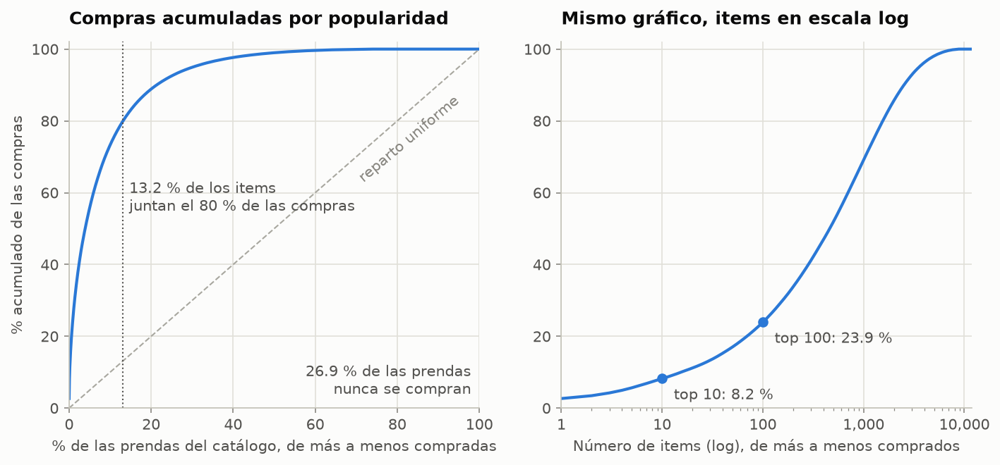
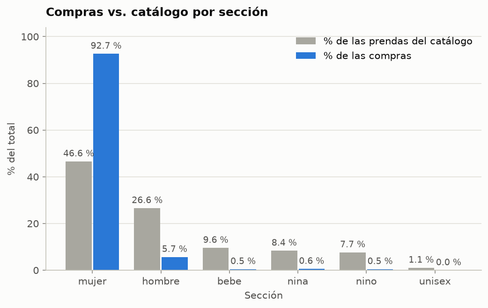
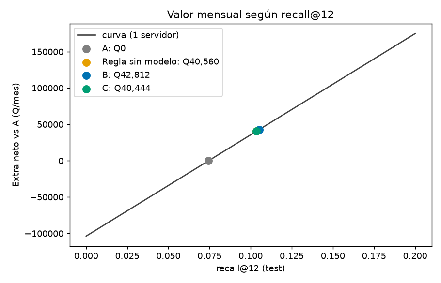
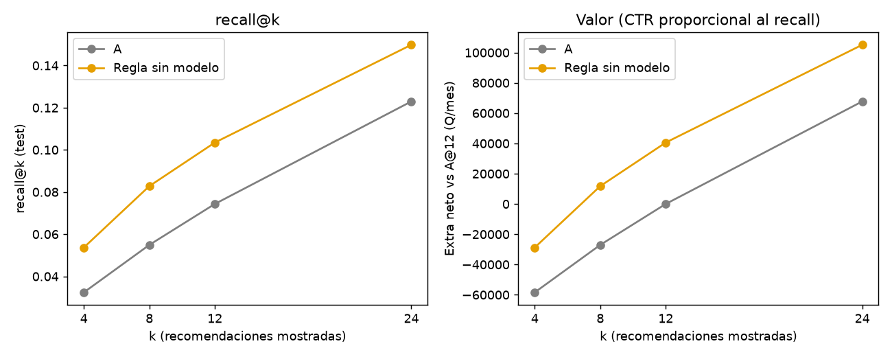
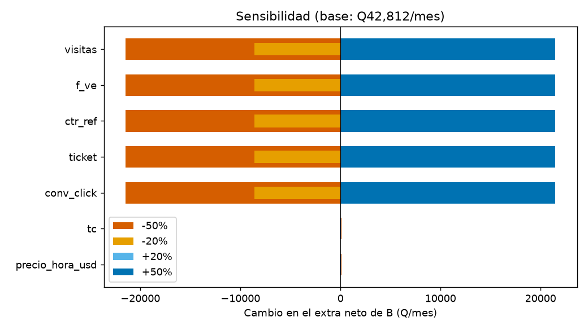
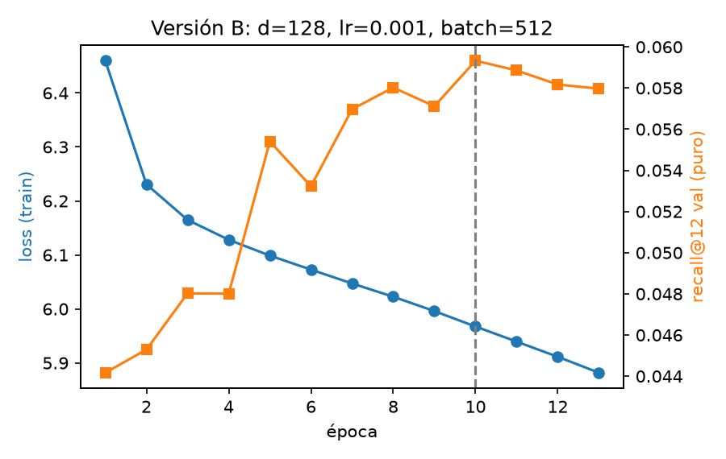
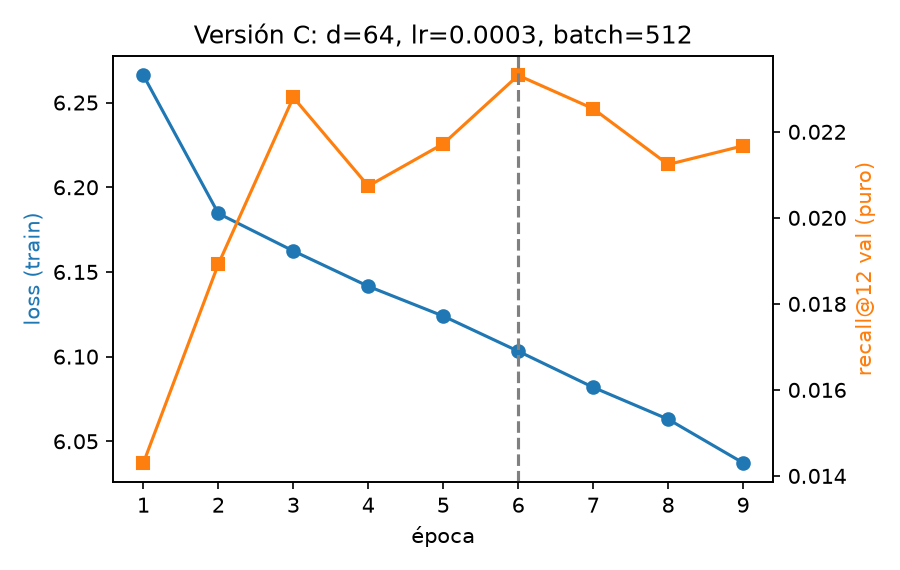
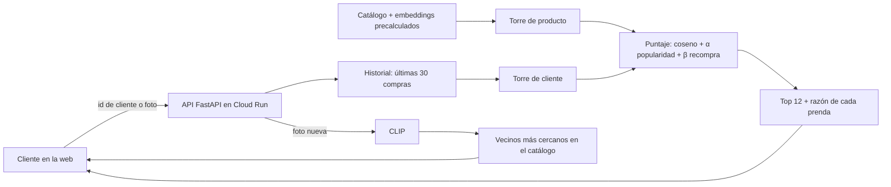
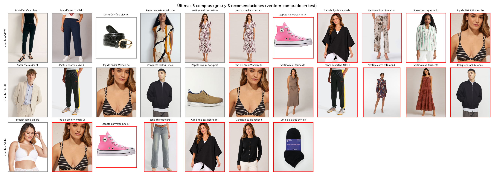
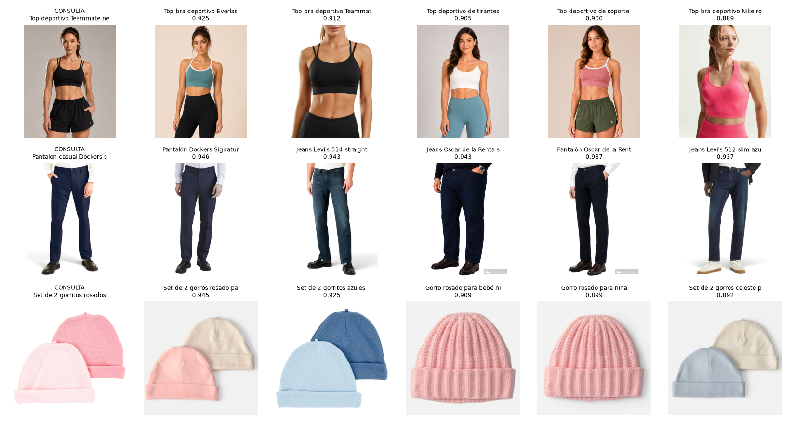

# Recomendador de moda para e-commerce en Guatemala

**Proyecto final, CC3092 Deep Learning y Sistemas Inteligentes (UVG, sección 20)**

**Equipo:** Javier Andre Benitez Garcia (23405) · Javier Alejandro López del Cid (23415) · Hugo Javier Cifuentes Carredano (23079)

**Fecha de entrega:** 18 de noviembre de 2026

## Resumen

Construimos y desplegamos un sistema que recomienda 12 prendas del catálogo de Siman Guatemala a cada cliente. El núcleo es un modelo two-tower entrenado por el equipo sobre embeddings preentrenados de texto e imagen (transfer learning por extracción de características). No se usa ningún LLM.

Resultados principales en la semana de prueba (4,592 clientes):

| Sistema | Recall@12 (IC 95 %) | Ventas extra al mes frente a A |
|---|---|---|
| A: los más vendidos | 0.0743 (0.0685 a 0.0805) | Q0 |
| Regla sin modelo (popularidad + recompra) | 0.1035 (0.0964 a 0.1111) | Q40,560 |
| B: two-tower con texto | 0.1052 (0.0978 a 0.1127) | Q42,812 (Q33,301 a Q53,052) |
| C: two-tower con texto e imagen | 0.1036 (0.0967 a 0.1110) | Q40,444 |

Tres conclusiones:

1. Pasar de la lista de más vendidos (A) al sistema B sube el recall@12 en 0.031 y equivale a unos Q42,800 más al mes, con un costo de servidor de Q167. El intervalo de confianza no incluye el cero.
2. Casi todo ese valor lo captura una regla sin deep learning. La ventaja de B sobre la regla es de Q2,253 al mes, con un intervalo de −Q2,477 a +Q7,054: no se distingue del ruido.
3. El entrenamiento sí mejora al modelo base preentrenado (recall puro de 0.042 a 0.063, +49 %), pero ni los embeddings preentrenados ni la imagen aportan de forma medible sobre las categorías y el id del producto.

---

## 4.1 Contexto de negocio y definición del problema

**Quién se beneficia.** Una tienda departamental en línea de Guatemala. Usamos el catálogo real de moda de Siman GT (11,786 prendas, 215 marcas). El usuario final es el cliente que entra al sitio y ve un carrusel de "recomendado para ti"; el dueño del proceso es el equipo de e-commerce de la tienda.

**Cómo se resuelve hoy.** No tenemos acceso a los sistemas internos de Siman. Tomamos como punto de partida la práctica más simple y común: mostrar a todos la misma lista de los más vendidos de la semana. Esa es la versión A y la referencia de todo el modelo de valor.

**Cuánto cuesta el problema.** Una lista igual para todos acierta poco: en nuestra prueba, solo el 7.4 % de lo que un cliente compra en la semana estaba entre las 12 prendas mostradas. Cada acierto que no se muestra es un clic y una posible venta que el carrusel no genera.

**Por qué deep learning.** El catálogo tiene cola larga: el 26.9 % de las prendas nunca recibe una compra y 461 prendas concentran la mitad de las ventas. Un modelo que solo aprende por identificador no puede recomendar prendas sin historial; un modelo que entiende el contenido (texto y foto) sí. Además, permite recomendar a partir de una foto que no está en el catálogo. Por eso elegimos una arquitectura two-tower con embeddings de contenido.

**Alternativas más simples que consideramos.** Dos, y las medimos:

- A: los 12 más vendidos de la semana anterior.
- Regla sin modelo: popularidad de la semana más recompra (prendas que el cliente ya compró, con peso que decae con el tiempo).

La regla resultó muy fuerte. Lo reportamos tal cual en las secciones 4.5 y 4.8, porque es el hallazgo más relevante para el negocio.

**KPIs.**

| KPI | Valor actual (línea base, versión A) |
|---|---|
| Recall@12 del carrusel | 0.0743 |
| CTR del carrusel | 2 % (supuesto) |
| Ventas al mes atribuidas al carrusel | Q103,542 (estimación del modelo de valor) |

---

## 4.2 Datos y análisis exploratorio

### Fuentes

| Fuente | Qué aporta | Volumen |
|---|---|---|
| API pública VTEX de Siman Guatemala (`src/scraping/scraper_siman.py`) | Catálogo: nombre, marca, categoría, color, descripción, precio, disponibilidad, foto | 11,786 prendas, 10,947 productos, 215 marcas |
| H&M Personalized Fashion Recommendations (Kaggle) | Patrón de compras de clientes reales | Muestra de 6 meses y 50,000 clientes: 539,807 transacciones |

No existen transacciones públicas de Siman. Por eso tomamos el comportamiento de compra de H&M y lo trasladamos al catálogo de Siman con un mapeo determinista.

### Mapeo de H&M a Siman

Cada artículo de H&M se asigna a una sola prenda de Siman (`src/data/mapeo.py`, reglas en `docs/reglas_mapeo.md`):

1. Se traduce el artículo a sección, tipo de prenda y color base con diccionarios hechos a mano.
2. Se buscan candidatos por niveles: misma sección, tipo y color; luego misma sección y tipo; luego mismo tipo y grupo de edad.
3. Dentro de los candidatos se elige por posición relativa de precio (cuantiles), para conservar el orden de precios.

| Nivel de mapeo | % de artículos | % de transacciones |
|---|---|---|
| 1: sección + tipo + color | 90.4 | 94.6 |
| 2: sección + tipo | 7.5 | 3.9 |
| 3: grupo de edad + tipo | 0.3 | 0.0 |
| Sin mapear (se descartan) | 1.8 | 1.4 |

Quedan 532,212 compras de 49,891 clientes sobre 8,614 prendas.

**Representatividad.** Este es el supuesto más fuerte del proyecto. Nadie compró esas prendas de Siman: el mapeo traslada un patrón de Europa en 2020 a otro catálogo, otro país y otra época. Las métricas miden qué tan bien se recupera ese patrón simulado, no ventas reales en Guatemala.

### Hallazgos del EDA

Catálogo (`notebooks/01_eda.ipynb`):

- Sin valores nulos en las 17 columnas.
- Mujer (46.6 %) y hombre (26.6 %) suman el 73.2 % de las prendas.
- Precio con cola larga: mediana Q219, percentil 90 Q503, máximo Q3,449.
- El 39.2 % de las filas comparte descripción con otra. Por eso el texto que se convierte en embedding empieza con nombre, categoría y color, y deja la descripción al final.
- Solo el 64.9 % de las prendas está disponible.

Transacciones (`notebooks/02_eda_transacciones.ipynb`):

- Historiales cortos: mediana de 6 compras por cliente; el 10.3 % compró una sola vez.
- Cola larga: 461 prendas (3.9 % del catálogo) concentran el 50 % de las compras; el 26.9 % nunca se compra.
- Sesgo hacia mujer: 92.7 % de las compras con 46.6 % del catálogo.
- Arranque en frío: cerca de 1 de cada 5 clientes de prueba no tiene historial en entrenamiento.
- Recompra baja: 3.1 % de los pares (cliente, prenda) de prueba ya se habían comprado antes.





### Preprocesamiento

- Limpieza del catálogo (`src/data/limpieza.py`): se descartan las prendas sin precio real (la API las marca con un precio centinela de 10,000,000) y se derivan sección, tipo de prenda (55 tipos), color base (15 colores) y porcentaje de descuento.
- Precio discretizado en 5 rangos por quintiles para usarlo como variable categórica.
- Embeddings de texto e imagen calculados una sola vez y guardados (`src/models/embeddings.py`).

### División de los datos

La división es temporal, porque así se usa un recomendador en la realidad: se entrena con el pasado y se predice la semana siguiente.

| Conjunto | Fechas | Compras | Clientes |
|---|---|---|---|
| Entrenamiento | 24-mar a 8-sep de 2020 | 499,647 | 48,186 |
| Validación | 9 a 15-sep | 16,664 | 4,773 |
| Prueba | 16 a 22-sep | 15,901 | 4,592 |

**Fugas de información.** Los conjuntos no se traslapan y son consecutivos. La popularidad que usa cada evaluación sale de la semana anterior al periodo evaluado, nunca del mismo periodo. Todos los hiperparámetros y pesos de combinación se eligen en validación; prueba solo se usa para reportar.

### Privacidad y licencias

- Los clientes de H&M vienen identificados con un código anónimo; no hay nombres ni datos de contacto.
- El dataset de H&M está sujeto a las reglas de la competencia de Kaggle. Lo usamos solo con fines académicos y no se redistribuye en el repositorio.
- El catálogo y las fotos son de Siman y se obtuvieron de su API pública. Se usan solo para este proyecto académico; los datos crudos no se suben a GitHub.

---

## 4.3 Modelo de valor

### Función de valor

Código en `src/evaluation/modelo_valor.py`. Para cada versión v, con A como referencia:

```
ventas_v = visitas × f_ve × CTR_v × conv_click × ticket
CTR_v    = ctr_ref × recall_v / recall_A
costo_v  = horas_mes × precio_hora × tipo_de_cambio × instancias_v
extra_v  = (ventas_v − ventas_A) − (costo_v − costo_A)        [Q al mes]
```

La idea central: si el carrusel muestra más prendas que el cliente quiere, recibe más clics. Suponemos que el CTR crece en proporción al recall@12.

### Supuestos y fuentes

Detalle y citas en `docs/supuestos_valor.md`.

| Supuesto | Valor | Rango plausible | Fuente |
|---|---|---|---|
| Visitas al mes | 321,000 | 226,000 a 600,000 | Semrush, tráfico de siman.com (sep-2026). Es tráfico de El Salvador; el de Guatemala no apareció con fuente |
| Fracción que ve el carrusel | 50 % | 25 a 75 % | Estimación del equipo |
| CTR del carrusel con A | 2 % | 1 a 4 % | Estimación del equipo |
| Compra tras el clic | 3.6 % | 0.8 a 3.6 % | Salesforce Shopping Index: 0.8 % en Latinoamérica × 4.5 para quien hace clic en una recomendación |
| Ticket | Q896 | Q400 a Q1,100 | Datos del proyecto: 3.55 prendas × Q252 |
| Tipo de cambio | Q7.63 por USD | 7.50 a 7.80 | Banguat, abril de 2026 |
| Costo de CPU | US$0.03 por hora | 0.03 a 0.06 | Tarifa publicada de Hugging Face Spaces (CPU Upgrade) |

Son estimaciones la fracción que ve el carrusel, el CTR de referencia y el ticket. El costo de CPU es una tarifa de referencia: el despliegue final quedó en Google Cloud Run y no medimos su factura real.

Instancias: A y la regla no necesitan servidor de modelo (0); B usa 1; C usa 2 porque carga CLIP.

### Valor por versión

| Versión | Recall@12 | Ventas al mes | Extra frente a A | Costo de servidor | Extra neto |
|---|---|---|---|---|---|
| A | 0.0743 | Q103,542 | Q0 | Q0 | Q0 |
| Regla sin modelo | 0.1035 | Q144,102 | Q40,560 | Q0 | Q40,560 |
| B | 0.1052 | Q146,521 | Q42,979 | Q167 | Q42,812 |
| C | 0.1036 | Q144,320 | Q40,778 | Q334 | Q40,444 |

### Curva de valor



Con estos supuestos, cada 0.01 de recall@12 equivale a unos Q13,900 de ventas al mes. El costo de servidor (Q167) se paga con una mejora de recall de apenas 0.0001.

También medimos cómo cambia el recall con el número de prendas mostradas:

| Prendas mostradas (k) | A | Regla sin modelo |
|---|---|---|
| 4 | 0.0324 | 0.0537 |
| 8 | 0.0549 | 0.0828 |
| 12 | 0.0743 | 0.1035 |
| 24 | 0.1229 | 0.1498 |



Esta curva solo se calculó para A y la regla. Además supone que el CTR sigue al recall sin que la atención del cliente se diluya al mostrar más prendas, lo cual es optimista para k grande.

### Análisis de sensibilidad



| Cambio en un supuesto | Efecto en el extra neto de B |
|---|---|
| Visitas, fracción que ve, CTR, conversión o ticket ±20 % | ±20.1 % (±Q8,596) |
| Los mismos ±50 % | ±50.2 % (±Q21,490) |
| Tipo de cambio o costo de CPU ±50 % | ±0.2 % (±Q84) |
| Todos en su extremo pesimista | Q422 al mes |
| Todos en su extremo optimista | Q295,706 al mes |

Los cinco supuestos de demanda mueven el valor de forma proporcional; el costo de cómputo casi no importa. El nivel absoluto en quetzales es incierto (de Q422 a Q295,706), pero la comparación entre versiones no depende de esos supuestos: todos multiplican por igual a cada versión.

### Punto de operación

El sistema combina tres señales:

```
puntaje = coseno(cliente, prenda) + α × popularidad + β × recompra
```

Elegimos (α, β) en validación entre 36 combinaciones. Como el valor crece de forma monótona con el recall y el costo no depende de α ni β, elegir por recall@12 es lo mismo que elegir por valor. Para B el punto óptimo fue α = 0.1 y β = 1. El número de prendas se fijó en k = 12, el tamaño del carrusel.

Elegir por valor sí cambia la decisión entre versiones: C tiene un recall parecido a B pero cuesta el doble de servidor, y la regla sin modelo no cuesta nada. Ver sección 4.8.

---

## 4.4 Metodología de desarrollo

### Arquitecturas consideradas

| Versión | Qué usa | Deep learning |
|---|---|---|
| A | Los 12 más vendidos de la semana anterior | No |
| B | Two-tower: historial + texto + categorías | Sí |
| C | B + embeddings de imagen | Sí |

Elegimos la arquitectura two-tower porque es el estándar para recuperación en recomendadores: separa al cliente y a la prenda en dos redes que producen vectores en el mismo espacio, y recomendar es buscar las prendas más cercanas al vector del cliente. Esto permite calcular los vectores de las 11,786 prendas una sola vez y responder en milisegundos.

### Arquitectura final

Código en `src/models/two_tower.py`.

- **Torre de producto.** Entrada: embedding de texto (768 dimensiones, congelado), embedding de imagen (512, congelado, solo C), cuatro embeddings aprendidos de 16 dimensiones (sección, tipo de prenda, color y rango de precio) y un embedding aprendido de 32 dimensiones por id de prenda. Todo se concatena y pasa por una red Linear(256) → ReLU → Linear(d), con normalización L2.
- **Torre de cliente.** Promedio de los vectores de producto de sus últimas 30 compras, con peso exp(−días / 30) para dar más importancia a lo reciente. Pasa por Linear(256) → ReLU → Linear(d), con normalización L2.
- **Puntaje.** Coseno entre el vector del cliente y el de cada prenda.

Los clientes sin historial reciben la lista de más vendidos.

### Función de pérdida

Softmax contrastivo con negativos dentro del batch y temperatura 0.05. Para cada par (cliente, prenda comprada), las prendas de los demás pares del batch sirven de ejemplos negativos. Dos ajustes:

- **Corrección logQ.** Las prendas populares aparecen más como negativos y el modelo aprende a castigarlas de más. Se corrige restando el logaritmo de la frecuencia de cada prenda.
- **Máscara de falsos negativos.** Si la misma prenda aparece dos veces en el batch, no se cuenta como negativo.

Alineación con el negocio: la pérdida ordena la prenda comprada por encima de las demás, que es justo lo que mide el recall@12 y lo que el modelo de valor convierte en clics.

### Optimización e hiperparámetros

- Optimizador Adam.
- Parada temprana con paciencia de 3 épocas según el recall@12 de validación; máximo 20 épocas.
- Búsqueda en rejilla de 8 configuraciones sobre la mejor iteración: dimensión d en {64, 128}, tasa de aprendizaje en {1e-3, 3e-4} y batch en {512, 2048}.
- Semilla fija (42). No se usó dropout ni decaimiento de pesos; la regularización viene de la parada temprana.

Configuración ganadora de B: d = 128, tasa 1e-3, batch 512, logQ, 12 semanas de entrenamiento e id de prenda.

### Modelos preentrenados y transfer learning

Aplicamos transfer learning por extracción de características: dos modelos preentrenados se usan congelados y sobre sus vectores se entrena nuestra red.

| Componente | Origen | ¿Se entrena? |
|---|---|---|
| Embedding de texto (768) | `intfloat/multilingual-e5-base` | No, congelado |
| Embedding de imagen (512, solo C) | `openai/clip-vit-base-patch32` | No, congelado |
| Embeddings de categorías y de id | Propio | Sí |
| Torres de producto y cliente | Propio | Sí |

Costo computacional: los embeddings se calculan una sola vez para las 11,786 prendas y se guardan en disco. Cada entrenamiento del two-tower tarda entre 7 y 74 segundos en una laptop (Apple MPS), así que el costo de entrenamiento es despreciable. No se hizo fine-tuning de los pesos de e5 ni de CLIP.

La comparación contra el modelo base está en la sección 4.5.

---

## 4.5 Resultados de iteraciones

### Tabla de iteraciones (versión B)

Cada iteración agrega un cambio a la anterior. El valor es el extra neto frente a A con la función de la sección 4.3 y un servidor (Q167).

| Iteración | Cambio | Épocas | Tiempo | Recall@12 val | Recall@12 prueba | Extra neto al mes |
|---|---|---|---|---|---|---|
| it1 | Base: d = 64, 4 semanas de entrenamiento | 9 | 11 s | 0.0980 | 0.1063 | Q44,294 |
| it2 | + corrección logQ | 6 | 7 s | 0.0973 | 0.1015 | Q37,632 |
| it3 | + 12 semanas de entrenamiento | 10 | 38 s | 0.0977 | 0.1035 | Q40,398 |
| it4 | + embedding de id de prenda | 15 | 60 s | 0.0983 | 0.1054 | Q43,046 |
| it5 | Rejilla de 8 configuraciones; gana d = 128 | 13 | 63 s | 0.0988 | 0.1052 | Q42,812 |

Notas:

- La versión final se eligió por validación (it5). En prueba, it1 queda un poco más arriba, pero la diferencia está dentro del ruido que medimos más abajo.
- No registramos recall sobre el conjunto de entrenamiento; las curvas muestran la pérdida de entrenamiento y el recall de validación.
- La tabla completa, con las 24 corridas de B y C, está en `reports/resultados/iteraciones.csv`.

### Curvas de entrenamiento





### Problemas encontrados

- **Sesgo de popularidad.** En it1 el modelo solo (sin popularidad ni recompra) daba un recall de 0.022 en prueba. La corrección logQ lo subió a 0.071.
- **Sobreajuste.** La pérdida de entrenamiento sigue bajando cuando el recall de validación ya se estancó; en la corrida final el mejor recall llega en la época 10 de 13 y la parada temprana corta ahí.
- **Conjuntos pequeños por sección.** Bebé, niña y niño tienen menos de 10 clientes cada uno en prueba; sus métricas no son confiables.

### Ablación: qué aporta cada pieza

| Variante | Recall@12 prueba |
|---|---|
| A: popularidad | 0.0743 |
| Popularidad + recompra, sin modelo | 0.1035 |
| B solo (modelo puro) | 0.0629 |
| B + popularidad | 0.0823 |
| B + popularidad + recompra | 0.1052 |

El modelo puro queda por debajo de la popularidad. La mayor parte del recall del sistema final viene de la popularidad y de la recompra.

### Transfer learning: comparación contra el modelo base

Para medir qué aporta nuestro entrenamiento sobre los modelos preentrenados, comparamos tres variantes (`python src/models/two_tower.py --transfer`):

- **Modelo base, sin entrenar:** los embeddings preentrenados tal cual. El cliente es el promedio ponderado de los embeddings de sus compras y se recomienda por coseno.
- **Two-tower sin preentrenados:** nuestra red solo con categorías e id.
- **Modelo completo:** nuestra red sobre los embeddings preentrenados.

Recall@12 en prueba. "Puro" es solo el modelo; "combinado" suma popularidad y recompra. Entre paréntesis, el cambio frente al modelo base.

| Variante | B puro | B combinado | C puro | C combinado |
|---|---|---|---|---|
| Modelo base (sin entrenar) | 0.0421 | 0.1043 | 0.0401 | 0.1035 |
| Two-tower sin preentrenados | 0.0624 (+0.0202) | 0.1061 (+0.0017) | no aplica | no aplica |
| Modelo completo | 0.0629 (+0.0208) | 0.1052 (+0.0008) | 0.0596 (+0.0195) | 0.1064 (+0.0029) |

En esta tabla B y C usan la misma configuración (la ganadora de B), para que la única diferencia sea la imagen.

- El entrenamiento mejora al modelo base en 49 % en recall puro, tanto en B como en C.
- Los embeddings preentrenados casi no aportan: sin ellos, el two-tower rinde igual.
- La imagen no mejora de forma medible.

Nota sobre el modelo C desplegado: se eligió por validación y ganó con otra configuración (d = 64, sin logQ, 4 semanas, sin id). Su recall puro es 0.0214, por debajo de su modelo base, y combinado llega a 0.1036. Esa caída viene de no usar logQ, no de la imagen.

Tablas completas: `reports/resultados/transfer_B.csv` y `transfer_C.csv`.

### Incertidumbre

Medimos dos fuentes de ruido (`python src/evaluation/incertidumbre.py`).

**Ruido de muestreo.** Bootstrap con 2,000 remuestreos de los 4,592 clientes de prueba, con diferencias pareadas.

| Comparación | Diferencia de recall | Diferencia al mes | IC 95 % al mes | Remuestreos a favor |
|---|---|---|---|---|
| B − A | +0.0309 | +Q42,812 | Q33,301 a Q53,052 | 100 % |
| Regla − A | +0.0291 | +Q40,560 | Q32,415 a Q49,566 | 100 % |
| B − regla | +0.0017 | +Q2,253 | −Q2,477 a +Q7,054 | 81 % |
| C − B | −0.0016 | no calculado | no calculado | 18 % (en recall) |

**Ruido de entrenamiento.** Cinco semillas con la configuración de B. Recall@12 combinado en prueba, media ± desviación estándar:

| Variante | Recall@12 |
|---|---|
| B (texto) | 0.1058 ± 0.0008 |
| C con la configuración de B (texto + imagen) | 0.1064 ± 0.0009 |
| B sin embeddings preentrenados | 0.1061 ± 0.0011 |

Lectura:

- La mejora de B sobre A es sólida.
- La mejora de B sobre la regla no se puede afirmar con este conjunto de prueba. Las cinco semillas de B quedan por encima de la regla (0.1050 a 0.1068 frente a 0.1035), así que la dirección es consistente, pero el intervalo incluye el cero.
- Las tres variantes del two-tower son indistinguibles entre sí.

Los intervalos en quetzales solo recogen el ruido del recall; no incluyen la incertidumbre de los supuestos del modelo de valor, que se trata en el análisis de sensibilidad.

---

## 4.6 Despliegue y experiencia de usuario

### Arquitectura



- **Entrada:** id de cliente, o una foto o id de prenda.
- **Preprocesamiento:** se arma el historial reciente del cliente; una foto pasa por CLIP.
- **Modelo:** two-tower (B o C) cargado en memoria al arrancar; los vectores de las prendas se calculan una sola vez.
- **Posprocesamiento:** se suma popularidad y recompra, se toma el top 12 y se genera la razón de cada recomendación.
- **Interfaz:** página web tipo tienda que muestra A, B y C lado a lado con foto, precio y razón.

Endpoints (`src/api/main.py`):

| Endpoint | Qué hace |
|---|---|
| `GET /recomendar/{cliente_id}?version=A\|B\|C&k=12` | Devuelve las prendas recomendadas |
| `POST /similares` | Recibe una foto o un id de prenda y devuelve prendas parecidas |
| `GET /historial/{cliente_id}` | Últimas 6 compras del cliente |
| `GET /clientes` | Clientes de demostración |
| `GET /salud` | Verificación de estado |

Se despliega con Docker en Google Cloud Run (2 GB de memoria, 1 CPU, escala a cero). URL: https://recomendador-de-moda-597180544725.us-central1.run.app

### Métricas operativas

Medidas en CPU con `python src/api/main.py --medir` (cliente HTTP en memoria, sin red).

| Endpoint | Versión | p50 | p95 | Solicitudes por segundo | USD por 1,000 predicciones |
|---|---|---|---|---|---|
| /recomendar | A | 0.9 ms | 1.1 ms | 891 | 0.000009 |
| /recomendar | B | 2.0 ms | 2.6 ms | 482 | 0.000017 |
| /recomendar | C | 1.7 ms | 2.3 ms | 564 | 0.000015 |
| /similares con foto | no aplica | 35.6 ms | 43.7 ms | 28 | 0.000301 |

El costo por predicción usa la tarifa de referencia de US$0.03 por hora. Estas cifras no incluyen la latencia de red ni el arranque en frío de Cloud Run cuando el servicio escala desde cero.

### Efecto en la experiencia del usuario

- Con A, todos ven las mismas 12 prendas. Con B, el cliente ve prendas relacionadas con lo que ya compró y la razón de cada una.
- En promedio, B acierta 0.105 de lo que el cliente compra en la semana frente a 0.074 de A: menos búsqueda manual para llegar a lo que quiere.
- La respuesta llega en menos de 3 ms de cómputo, así que el carrusel no agrega espera perceptible.

No hicimos pruebas con usuarios reales ni pruebas A/B. La relación entre recall y clics es un supuesto del modelo de valor.

### Errores, casos límite e incertidumbre

| Caso | Qué hace el sistema |
|---|---|
| Cliente nuevo o sin historial | Muestra los más vendidos y lo dice: "Cliente nuevo: lo más vendido esta semana" |
| Versión inválida | Error 400 con mensaje |
| Archivo que no es imagen o prenda inexistente | Error 400 con mensaje |
| k fuera de rango | Se limita entre 1 y 50 |

La incertidumbre se comunica con la razón de cada prenda: el cliente ve si la recomendación viene de su historial ("Parecido a X, que compraste"), de una recompra o de la popularidad general.

### Plan de monitoreo

No está implementado; es lo que haríamos en producción:

- **Recall@12 semanal** contra las compras reales de la semana, con alerta si baja de la regla sin modelo.
- **CTR y conversión del carrusel** por versión, con una prueba A/B permanente contra A.
- **Cobertura del catálogo:** porcentaje de prendas distintas que se recomiendan, para detectar concentración.
- **Porcentaje de clientes sin historial** y de prendas nuevas sin embedding.
- **Latencia p95 y tasa de errores** de la API.
- **Reentrenamiento semanal**, porque la popularidad y el catálogo cambian cada semana.

---

## 4.7 Explicabilidad, ética y riesgos

### Explicabilidad

Usamos explicación por ejemplos, que es la natural en un modelo de embeddings. Para cada prenda recomendada (`src/models/recommend.py`):

1. Si el cliente ya la compró: "Lo compraste hace N días".
2. Si la popularidad pesa más que la afinidad del modelo: "Popular esta semana".
3. Si no: "Parecido a X, que compraste", donde X es la prenda del historial más cercana en el espacio del modelo.



Para la búsqueda por foto, mostramos los vecinos más cercanos de CLIP con su similitud:



La ablación de la sección 4.5 es la otra herramienta de explicabilidad: revela que la popularidad y la recompra explican la mayor parte del acierto, y que el modelo puro aporta poco. No aplicamos SHAP ni mapas de atención; el modelo no tiene capas de atención y la explicación por vecino más cercano responde de forma directa "por qué esta prenda".

### Sesgos

Recall@12 de B en prueba por sección del cliente:

| Sección | Clientes | A | B |
|---|---|---|---|
| Mujer | 3,542 | 0.0745 | 0.1081 |
| Hombre | 112 | 0.0969 | 0.1151 |
| Sin historial | 916 | 0.0701 | 0.0928 |
| Bebé | 9 | 0.1077 | 0.0707 |
| Niña | 7 | 0.0833 | 0.1071 |
| Niño | 6 | 0.1111 | 0.1111 |

- **Sesgo de los datos hacia mujer.** El 92.7 % de las compras es de mujer. El modelo se entrena y se evalúa casi solo con ese grupo.
- **Grupos sin evidencia.** Bebé, niña y niño tienen menos de 10 clientes en prueba; no podemos afirmar si el modelo funciona para ellos. Hombre tiene 112.
- **Clientes sin historial.** Son 1 de cada 5 y reciben la experiencia menos personalizada.
- **Sesgo de popularidad.** El sistema refuerza lo que ya se vende. Las marcas pequeñas (85 de 215 tienen menos de 10 prendas) y las prendas nuevas quedan con poca exposición.

Costo de estos errores: para el negocio, ventas perdidas en hombre y niños, que suman el 52 % del catálogo; para las marcas pequeñas, menos visibilidad; para el cliente, un carrusel repetitivo.

### Riesgos y cuándo no usarlo

- **No usarlo como evidencia de ventas reales en Guatemala.** Las compras son simuladas con el mapeo desde H&M.
- **No usarlo para decidir inventario o precios.** Solo ordena prendas para un carrusel.
- **Privacidad.** Un recomendador puede revelar compras sensibles (ropa interior, maternidad, tallas) a quien vea la pantalla. En producción habría que excluir categorías sensibles de la razón "Lo compraste" y dar al cliente la opción de desactivar la personalización.
- **Disponibilidad.** El 35 % del catálogo no está disponible; en producción hay que filtrar por existencias antes de mostrar.
- **Datos personales.** En producción se usarían compras de clientes reales; requeriría consentimiento y una política de retención.

---

## 4.8 Discusión y conclusiones

### Qué cambios tuvieron más impacto en el valor

| Cambio | Efecto en recall@12 | Efecto al mes |
|---|---|---|
| Agregar la regla de recompra | +0.023 | Cerca de Q32,000 |
| Agregar popularidad al modelo | +0.019 | Cerca de Q27,000 |
| Corrección logQ (modelo puro) | +0.049 puro, sin mejora combinado | Sin mejora medible |
| Agregar el two-tower a la regla | +0.0017 | Q2,253, no distinguible de cero |
| Agregar imagen | −0.0016 | Negativo: duplica el costo de servidor |

Los efectos en quetzales de las dos primeras filas son aproximados: resultan de aplicar Q13,900 por cada 0.01 de recall a las diferencias de la ablación.

Los cambios de mayor impacto en el valor no fueron de deep learning. Y el cambio de mayor impacto en la métrica técnica del modelo (logQ, que triplicó el recall puro) no cambió el valor, porque la popularidad ya cubría lo mismo en el sistema combinado.

### Rendimientos decrecientes

El punto llega pronto. Una regla de pocas líneas captura Q40,560 de los Q42,812. Después de eso, cinco iteraciones del modelo, una rejilla de hiperparámetros y los embeddings de imagen movieron el resultado dentro de una banda de 0.002 de recall, que es el tamaño del ruido entre semillas. Con estos datos, seguir afinando el modelo no vale la pena.

### Complejidad, costo y valor

| Versión | Complejidad | Costo al mes | Valor al mes frente a A |
|---|---|---|---|
| Regla sin modelo | Muy baja | Q0 | Q40,560 |
| B | Media: entrenamiento y servidor | Q167 | Q42,812 |
| C | Alta: además CLIP y más memoria | Q334 | Q40,444 |

Si la decisión fuera solo por valor, recomendaríamos poner en producción la regla y dejar B en una prueba A/B. C no se justifica.

El modelo sí aporta dos capacidades que la regla no tiene y que el recall@12 no mide: recomendar prendas que nunca se han vendido (26.9 % del catálogo) y buscar por foto.

### Por qué el modelo aporta poco aquí

- **El mapeo concentra las compras.** Cada artículo de H&M va a una sola prenda de Siman; donde Siman tiene poca oferta, muchas compras caen en pocas prendas. Eso favorece a la popularidad.
- **El mapeo borra información fina.** Se asigna por sección, tipo, color y precio. Los embeddings de texto e imagen describen detalles que el mapeo no conserva, y las cuatro variables categóricas ya contienen casi todo lo que el mapeo deja pasar.
- **Historiales cortos.** Mediana de 6 compras por cliente.
- **Conjunto de prueba de una semana.** Con 4,592 clientes, el intervalo del recall es de ±0.007; no alcanza para detectar mejoras de 0.002.

### Limitaciones

- Las transacciones son simuladas; el resultado no es una predicción de ventas en Guatemala.
- Varios supuestos del modelo de valor son estimaciones del equipo, y el tráfico usado es de El Salvador.
- La relación lineal entre recall y CTR no está validada con usuarios.
- No se hizo fine-tuning de e5 ni de CLIP.
- No hay pruebas de usabilidad ni A/B.
- El entrenamiento en MPS no es determinista: la misma semilla varía cerca de 0.0001 a 0.0003 entre corridas.

### Viabilidad y siguientes pasos

El sistema es barato de operar (menos de Q350 al mes y respuestas en menos de 3 ms) y la tubería completa ya funciona de punta a punta. Lo que falta para producción es lo que este proyecto no podía tener:

1. **Transacciones reales de la tienda.** Es el paso que más cambiaría el resultado, porque quita el mapeo.
2. **Prueba A/B en el sitio** para medir el CTR real por versión y validar el modelo de valor.
3. **Fine-tuning del codificador de imagen o de texto** con las compras reales, que es donde el contenido debería aportar.
4. **Evaluar el arranque en frío por separado:** recall en prendas nuevas y en clientes sin historial, donde la regla no puede competir.
5. **Filtro de existencias y de categorías sensibles** antes de mostrar.

---

## 4.9 Repositorio

**Enlace:** https://github.com/JavierBenitez112/Proyecto_deep_learning

Contenido:

| Carpeta | Qué contiene |
|---|---|
| `src/scraping/` | Descarga del catálogo de Siman |
| `src/data/` | Limpieza, muestreo de H&M y mapeo |
| `src/models/` | Línea base, embeddings, two-tower y recomendador |
| `src/evaluation/` | Métricas, modelo de valor e incertidumbre |
| `src/api/` y `web/` | API y página de demostración |
| `notebooks/` | EDA y modelo de valor |
| `reports/` | Figuras, tablas de resultados y este documento |
| `docs/` | Enunciado, plan, reglas del mapeo y supuestos del modelo de valor |

Para reproducir las métricas, desde la raíz del repositorio:

```bash
python src/models/baseline.py                 # versión A
python src/models/embeddings.py               # embeddings de texto
python src/models/embeddings.py --imagen      # embeddings de imagen
python src/models/two_tower.py                # versión B
python src/models/two_tower.py --imagen       # versión C
python src/models/two_tower.py --transfer     # comparación contra el modelo base (agregar --imagen para C)
python src/evaluation/incertidumbre.py        # intervalos de confianza y 5 semillas
python src/evaluation/modelo_valor.py         # valor por versión y sensibilidad
python src/api/main.py --medir                # latencia
```
